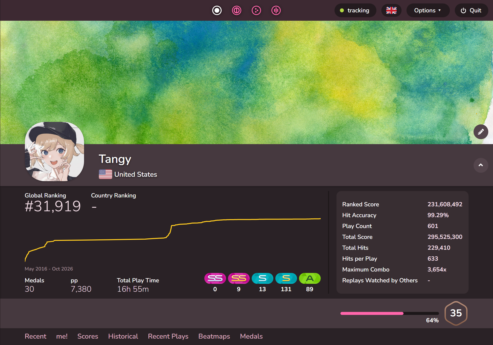
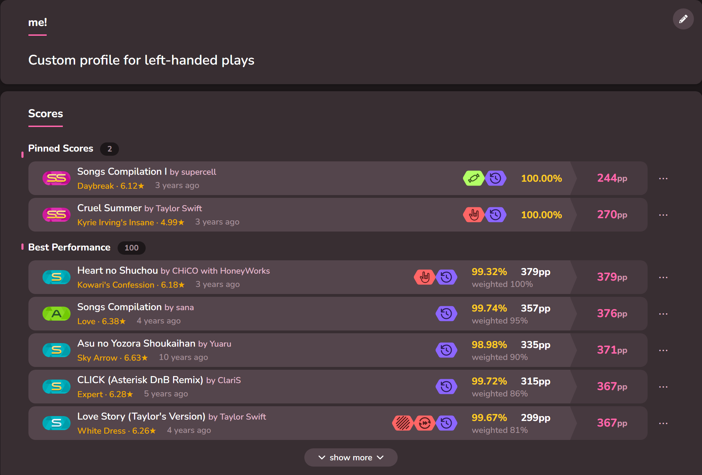

# osu! local profiles

[](https://github.com/jonathant09/osu-local-profiles/actions/workflows/ci.yml)
[](https://github.com/jonathant09/osu-local-profiles/releases/latest)
[](LICENSE)
[](https://github.com/jonathant09/osu-local-profiles/releases)
[](https://github.com/ppy/osu/releases)
[](https://github.com/jonathant09/osu-local-profiles/releases/latest)

App that tracks local, offline osu! profiles in a browser page, made to look like an official osu! profile. 

Inspired by [Sheppsu's project](https://github.com/Sheppsu/osu-score-tracker) and [Kariyu's video](https://youtu.be/5wVU4kYC3So).

[Preview profile](https://jonathant09.github.io/osu-local-profiles/) | [r/osugame post](https://www.reddit.com/r/osugame/comments/1wphvn7/osu_local_profiles_app_stable_lazer_4_gamemodes/)

**Features**

- Fully offline, no API key needed
- Unranked and loved pp, plus unranked mods in lazer
- Import an existing osu! profile: name, scores, avatar, etc.
- Filter which plays are tracked: ranked status, mods, mapper, etc.
- Remove scores
- pp recalculated automatically for pp reworks

**Useful for**

- Multiple profiles without multi-accounting
- Alternative playstyles: mouse, tablet, etc.
- Rank speedruns and restriction challenges

**Supports**

| Clients              | Game modes                    | Platforms             | Languages |
| -------------------- | ----------------------------- | --------------------- | --------- |
| stable, lazer, McOsu | standard, taiko, catch, mania | Windows, macOS, Linux | 16        |

**Last updated**

- **pp:** [osu! 2026.916.0](https://github.com/ppy/osu/releases/tag/2026.916.0), July 2026 pp rework
- **Global rank estimate:** [September 2026](https://data.ppy.sh/)

## Screenshots





## Installation

1. [Download the latest release](https://github.com/jonathant09/osu-local-profiles/releases/latest) for your OS and unzip the folder.
2. Run the app as follows:

| Platform | Start                                      | Location when running |
| -------- | ------------------------------------------ | --------------------- |
| Windows  | run `osu! local profiles.exe`              | system tray           |
| macOS    | run `osu! local profiles`                  | menu bar              |
| Linux    | run `./osu-local-profiles` or `./start.sh` | system tray           |

3. Open http://localhost:7272 in your browser.

**Mac users:** To allow the app to run, go to **System Settings -> Privacy & Security -> Open Anyway**, or run `xattr -dr com.apple.quarantine .` in the folder from Terminal.

## Building from source

```
dotnet run --project dotnet/App   # runs the app from this folder, on its data/ (needs the .NET 10 SDK)
npm install                       # for the packaging scripts
npm run package -- --native       # builds the release package for this system
npm run check:port                # runs the C# tests
```

Open <http://localhost:7272>. 
Go is only needed to build the tray launcher. Node.js 24 runs the packaging scripts and the old app's tests.

## Warnings for osu!stable

- **Unranked maps will always count for pp** if lazer isn't installed, since stable doesn't record ranked status
- Scores are only tracked once you exit the results screen
- Incomplete plays (fail, quit, retry) are not tracked

## Warnings for McOsu

- McOsu-only mods (Nightmare and experimental mods) show as one **MC** mod
- Incomplete plays (fail, quit, retry) are not tracked
- pp may differ between McOsu and this app

## Technologies Used

| Technology                         | Used for                       |
| ---------------------------------- | ------------------------------ |
| C# / .NET 10                       | app, self-contained            |
| ASP.NET Core (Kestrel)             | the local web server           |
| Microsoft.Data.Sqlite              | profiles database              |
| Vanilla DOM, ES modules and CSS    | profile page                   |
| Official `ppy.osu.Game.Rulesets.*` | official pp calculator         |
| Go + `fyne.io/systray`             | tray and menu bar launcher     |
| GitHub Actions                     | CI and cross-platform releases |

## Online fetches (optional)

| host            | assets fetched                                                |
| --------------- | ------------------------------------------------------------- |
| `assets.ppy.sh` | beatmap cover art and medal icons                             |
| `data.ppy.sh`   | rank-curve dumps when manually running `npm run rank:refresh` |
| `osu.ppy.sh`    | import existing profile details, scores, beatmaps             |
| `b.ppy.sh`      | song audio previews                                           |
| `github.com`    | check for new app updates                                     |

## Play tracking flow for completed plays

App watches for a new `.osr` replay file:

```
  lazer:  %APPDATA%/osu/files/**        ─┐
  stable: <osu!>/Data/r/*.osr           ─┴─→ new file detected (recursive fs.watch)
                                                     │
                            first bytes look like a replay?
                                                     ▼
                   parse .osr  →  mods, hits, combo, score, timestamp
                                                     ▼
                  beatmap MD5  →  beatmap id + ranked status   (offline)
                                                     ▼
         local .osu  →  osu!'s own difficulty/pp calculator  →  pp   (offline)
                                                     ▼
                          store → recompute profile → live update
```

Stable's `Songs` folder is watched to detect beatmaps downloaded while the app is running

## Incomplete plays (fail, quit, retry) - *lazer only*

App reads from lazer's session log to track incomplete plays:

```
  lazer:  %APPDATA%/osu/logs/<session>.runtime.log  ──→ osu! accepted a submission
                             <session>.network.log  ──→ ...for this beatmap
                                        │
                    did it reach a results screen?  ──yes──→ it is a pass; its replay
                                        │                    is already being tracked
                                        no
                                        ▼
                   an unfinished play: counted, with no score attached
```

## Limitations

- Require manual updates:
  - pp reworks
  - Global rank (estimate based on curve from data.ppy.sh). Refresh it with `node scripts/build-rank-table.mjs osu --dump YYYY_MM_DD`.
- Country rank not supported (small sample size)
- Incomplete plays (fail, quit, retry) not supported in stable and McOsu.

## Contributing

Pull requests are welcome. See [CONTRIBUTING.md](CONTRIBUTING.md).

## Credits

Thank you to [Sheppsu's project](https://github.com/Sheppsu/osu-score-tracker) and [Kariyu's video](https://youtu.be/5wVU4kYC3So) for the project inspiration.

- [FlareonGhh](https://github.com/starhollow2008/osu-local-profiles-ext-media) - Other icons provider: recent feed icons for level-ups and new bests (CC BY 4.0)
- [ppy/osu](https://github.com/ppy/osu) - official rulesets and performance calculator
- [ppy/osu-web](https://github.com/ppy/osu-web) - mod glyphs, grade badges, stable's grade letters, the guest avatar, default banner, mode icons, mod badge styling (AGPL-3.0-or-later, © ppy Pty Ltd), plus mod and medal definitions
- [data.ppy.sh](https://data.ppy.sh) - public ladder dumps behind the pp-to-rank curves
- [Twemoji](https://github.com/jdecked/twemoji) - country flag artwork
- [fyne.io/systray](https://github.com/fyne-io/systray), [godbus/dbus](https://github.com/godbus/dbus) and [golang.org/x/sys](https://pkg.go.dev/golang.org/x/sys) for the tray launcher
- [Nunito](https://github.com/googlefonts/nunito) - the page's font (SIL Open Font License)

Full license details in [THIRD-PARTY-NOTICES.md](THIRD-PARTY-NOTICES.md).

## License

[AGPL-3.0](LICENSE)

The page uses artwork and styling from [osu-web](https://github.com/ppy/osu-web) (© ppy Pty Ltd), under
osu-web's own AGPL-3.0 licence. See [THIRD-PARTY-NOTICES.md](THIRD-PARTY-NOTICES.md).

osu!'s Torus and Venera fonts are not included and are only used if already installed on your PC. Otherwise, Nunito font is used by the app.

This app does **not** log in to osu!, use API credentials, submit anything to your account, or automate/assist gameplay in any way.

"osu!" and "ppy" are trademarks of ppy Pty Ltd. This is an unofficial community project and is not affiliated with, endorsed by, or associated with osu! or ppy Pty Ltd.
